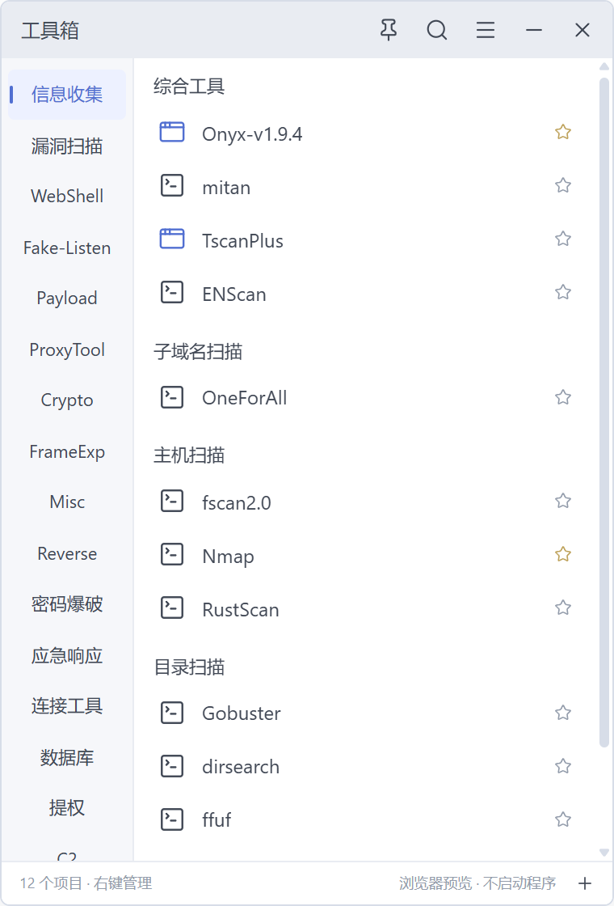
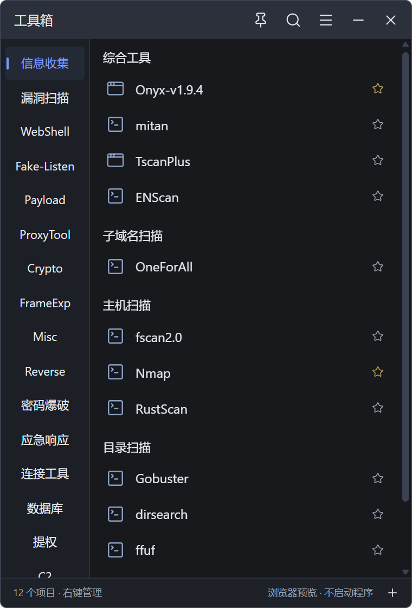

# QiBox 工具箱

Windows 上的紧凑型桌面工具箱：380 × 560 的小窗口，左侧分类、右侧分组列表，用来收纳常用的命令行工具、GUI 程序和脚本，一键启动。

界面按设计稿逐条迁移：白底 + 蓝灰 `#516fd1`、6 px 圆角、Lucide 图标本地打包；同时支持深色主题。




## 下载

到 [Releases](https://github.com/cmacckk/QiBox/releases) 下载：

- `QiBox_x.y.z_x64-setup.exe` — 安装版，装到 `%LocalAppData%\QiBox`，带开始菜单与桌面快捷方式
- `QiBox_x.y.z_portable_x64.zip` — 便携版，解压后直接运行 `qibox.exe`

系统要求：Windows 10/11 x64，WebView2 Runtime（Win11 及较新的 Win10 已内置）。
可执行文件未做代码签名，首次运行 Windows SmartScreen 会提示「更多信息 → 仍要运行」。

## 功能

### 主窗口
- 窗口可缩放（最小 360 × 520），记住尺寸和位置；超出显示器时自动回中
- 分类栏可放左侧/右侧/顶部/底部或隐藏，分类可加密（口令）
- 项目按分组显示，支持列表/图标/平铺三种视图、可调图标尺寸、拖动排序、收藏
- 批量选中后可改分类、改分组、收藏、复制、移动、删除
- 同一程序免安装：CLI / GUI / 脚本 / 网址 / 文件夹 / 内置 Windows 命令都能作为项目

### 启动
- 参数支持路径变量（见下表），工作目录、管理员权限（UAC）可选
- 脚本按解释器启动：`.ps1` → PowerShell，`.bat/.cmd` → cmd，`.py` → python，`.js` → node
- WSL：选发行版（自动读取 `wsl --list`）、设置 WSL 内工作目录，直接跑 Linux 命令
- 启动失败会提示具体原因（找不到目标 / WSL 启动失败），并写入 `logs/launch.log`

### 搜索
- 名称、分组、分类、关键词匹配，支持拼音全拼与首字母（`xxsj` → 信息收集）
- 可选正则模式；`↑ ↓` 选择、`Enter` 启动、`Alt + 数字` 直接启动第 n 条
- 输入 `>` `<` `#` 等前缀可直接用内置插件（Calc / Hash / Rand / Cmd / Run）

### 快捷键
- 全局显示/隐藏窗口、全局唤出搜索，点击即录制（如 `Ctrl + Alt + K`）
- 单个项目也能绑定全局热键
- `Ctrl + K` / `Ctrl + F` 搜索、`F2` 编辑、`F4` 设置、`Shift + F10` 菜单、`Esc` 逐层返回

### 托盘
- 只驻留系统托盘，不在任务栏显示（主窗口与各面板窗口都不占任务栏，也不进 Alt+Tab）
- 托盘菜单：显示 / 设置 / 隐藏 / 退出；单击托盘图标切换显示
- 关闭按钮的行为（隐藏到托盘 / 退出）、开机自启（`HKCU\...\Run`）、置顶均可切换
- 单实例运行，再次启动会把已有窗口叫到前台

### 外观
- 4 套主题（浅色/深色 × 蓝灰/中性灰），主题编辑器可改 40 个颜色槽、主色、圆角
- 主题可保存为 JSON 文件（`%AppData%\QiBox\themes\`）、导入、切换
- 背景图片：png/jpg/webp/gif/bmp/ico，5 种铺排 + 0–100 透明度
- 界面字体可选系统已安装字体；项目图标可用 Lucide 图标、图片，或从 exe/dll 自动抽取

### 数据
- 配置为单个 JSON：`%AppData%\QiBox\config.json`，改动后原子写入
- 每天自动备份一份，保留最近 10 份
- 支持导出/导入配置、数据预览、从 Maye Nano 的 `MDB.json` 迁移（合并或替换）

### 其它面板
- 任务计划：Quartz 表达式 + Cron 编辑器，生成 `schtasks` 命令文本供复制（**不会**自动注册任务）
- 进程管理：读取真实进程列表与内存占用，结束进程需二次确认
- 脚本引擎：在 Worker 沙箱里跑 `mn.*` API 脚本（日志、通知、剪贴板、打开目标），15 秒超时
- 插件：`plugin.json` 描述 + 脚本，可安装/启用/卸载，插件目录 `%AppData%\QiBox\plugins\`

## 路径变量

| 变量 | 含义 |
|---|---|
| `%mp%` | 程序所在目录（`qibox.exe` 的位置） |
| `%mr%` | 程序根目录 |
| `%cmacckkTools%` | 工具根目录，默认 `F:\MayeLite\cmacckkTools`，可在 设置 → 常规 里改 |
| `%so%` / `%so-url%` | 搜索框内容 / URL 编码后的内容 |
| `%name%` / `%path%` / `%category%` / `%group%` | 当前项目的名称、目标、分类、分组 |

图标字段还支持相对路径（相对程序目录），例如 `..\icons\mytool.ico`。

## 开发

```powershell
pnpm install

pnpm dev            # 浏览器预览 http://localhost:1420（不启动程序、不注册热键）
pnpm desktop:dev    # 桌面端调试（真实托盘、热键、启动行为）
pnpm build          # tsc --noEmit + vite build
pnpm desktop:build  # 打 NSIS 安装包到 src-tauri/target/release/bundle/nsis/
```

图标：`npx tauri icon path/to/icon.png` 会重新生成 `src-tauri/icons/` 全套尺寸。

技术栈：Tauri 2（Rust）+ 原生 TypeScript/CSS + Vite，无前端框架；图标 `lucide`，拼音 `pinyin-pro`，全部本地打包、不联网。

## 系统边界

- 会做的：启动你配置的程序/脚本（含 UAC 提权与 WSL）、注册你设置的全局热键、常驻托盘、读写自己的配置与日志、可选的开机自启（仅 `HKCU` 一个 Run 项）、结束你确认过的进程
- 不会做的：修改系统设置或其它软件的数据、写计划任务、静默执行未授权命令、上传任何数据
- 分类口令与项目密码只是本地明文存储的访问控制，不是安全加密

## 已知限制

- 未做代码签名，安装包可能触发 SmartScreen
- 手势、自动更新检查尚未实现
- 前端打包的是 Lucide 全量图标集（约 518 KB），后续可改为按需引入

## 目录结构

```text
src/               前端
  domain/          类型、路径变量
  state/           状态、持久化、口令锁
  services/        Tauri 调用、脚本引擎、Maye 迁移
  ui/              主窗口、菜单、字段、面板（settings/editor/theme/...）
  styles/          base.css（设计稿样式）+ app-shell.css（桌面窗口适配）
src-tauri/         Rust 后端（窗口、托盘、热键、启动、PE 图标抽取、插件、日志）
docs/              README 截图
```

## 许可

仓库暂未附带开源许可证文件，默认保留所有权利；如需引用请先开 issue 说明用途。
